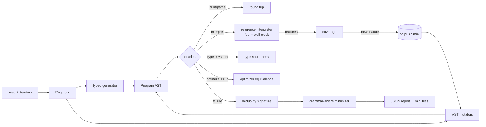

# AST-StateFuzzer


**A structure-aware fuzzer that generates and mutates typed syntax trees, checks them with differential oracles, and shrinks every failure to a reproducer you can read in one glance.**

> **Status: experimental, v0.1.0, not production-ready.** The initial target is *Mini*, a small language implemented in this repository. Pointing the engine at other languages means writing a generator, printer and oracles for them (see [Limitations](#limitations-and-roadmap)).

```console
$ astfuzz run --seed 1 --iterations 20000 --plant opt-sub-assoc --stop-on-first
seed 1 | 1750 executions (371 generated, 1400 mutated, 21 oversize skipped) | corpus 118 | features 244 | timeouts 6 | 70 ms
planted bugs enabled: opt-sub-assoc
1 unique finding(s)

[0] invariant-violation:optimizer-equivalence (iteration 1770, +0 duplicates)
    original:  output=[Int(17)] result=Err(Overflow)
    minimized 52 -> 8 nodes in 89 checks:
      let v0 = 1;
      print 0 - (0 - v0);
```

A deliberately planted optimizer bug (`a - (b - c)` rewritten as `(a - b) - c`) is found from seed 1 and the 52-node random program that exposed it is reduced to two lines. The variable stays because with a literal the optimizer constant-folds `0 - 1` first and the buggy rewrite never fires: the minimizer keeps exactly what the bug needs. (Measured on an Apple M5 under heavy load from other builds; times will differ on your machine.)

## Why

Byte-level fuzzers such as AFL++ and libFuzzer are superb at finding memory-safety bugs in parsers, but most inputs they produce for a compiler or interpreter die in the lexer. Bugs in **type checkers, optimizers and interpreters** need inputs that are *syntactically valid and mostly well-typed*, plus an **oracle** that can tell a wrong answer from a right one. Tools like Csmith (for C) and grammar fuzzers (for any CFG) solve the first half; AST-StateFuzzer is a small, readable Rust implementation of the whole loop:

- **typed AST generation and mutation**, so almost every input reaches the semantics;
- **differential oracles** (print → parse round trip, type soundness, optimizer equivalence) that catch *wrong results*, not just crashes;
- **crash / timeout / invariant-violation classification** with stable signatures for deduplication;
- **grammar-aware minimization** that only ever proposes valid smaller programs;
- **seeded reproducibility**: `(seed, iteration)` identifies an input exactly, on every platform.

It is meant for people building language tooling who want to learn how such a fuzzer works, and as a base to adapt to a real target.

## Quick start

```sh
git clone https://github.com/hellpuffyt/AST-StateFuzzer && cd AST-StateFuzzer
cargo build --release                       # Rust 1.85+
./target/release/astfuzz run --seed 1 --iterations 20000 --plant opt-sub-assoc --stop-on-first
./target/release/astfuzz replay --plant opt-sub-assoc fixtures/regressions/opt-sub-assoc.mini
cargo test --release
```

`run` exits **1** when it has findings, **0** when it has none and **2** on errors, so it can gate CI. `replay` on the minimized file prints the two diverging outcomes:

```console
$ astfuzz replay --plant opt-sub-assoc fixtures/regressions/opt-sub-assoc.mini
output: [Int(1)]
result: Ok(()) after 8 steps
FAIL invariant-violation:optimizer-equivalence
original:  output=[Int(1)] result=Ok(())
optimized: output=[Int(-1)] result=Ok(())
```

Without `--plant` the same file passes (`PASS (all oracles agree)`, exit 0).

## Features

**Implemented**
- *Mini* target: lexer, recursive-descent parser (nesting and size limits), canonical printer, static type checker, fuel-bounded reference interpreter, constant-folding optimizer. Spec: [`docs/LANGUAGE.md`](docs/LANGUAGE.md).
- Type-aware generator with depth / block / statement budgets and weights; bounded loop patterns; a configurable share of deliberately ill-typed operands.
- Eight AST mutation operators: replace subtree, hoist, operator swap, literal tweak, delete / duplicate / swap statements, splice from another corpus entry.
- Oracles: `roundtrip-parse`, `roundtrip-ast`, `type-soundness`, `optimizer-equivalence`; crash capture via `catch_unwind` with panic location; timeouts by fuel or wall clock (reported as findings only with `--timeouts-are-failures`).
- Execution-feature coverage feedback (statement kinds, operator × result class, operator nesting, branch direction, loop-count buckets, error kinds). **Not CFG coverage**, see [`docs/COVERAGE.md`](docs/COVERAGE.md).
- Grammar-aware minimizer: statement ddmin, statement unwrapping, expression hoisting / literal shrinking; keeps the exact failure signature; budgeted.
- Corpus on disk (`*.mini`), canonical-hash file names, canonical and behavioural deduplication, non-destructive `corpus dedup`.
- JSON report: seed, iteration, failure class and signature, details, reproducer, minimized program, minimization and campaign statistics.
- Four planted bugs (`opt-sub-assoc`, `print-sub-parens`, `typeck-eq-mixed`, `interp-rem-panic`) with acceptance tests and regression fixtures.

**Experimental**
- libFuzzer harness (`fuzz/`, nightly + `cargo-fuzz`): libFuzzer's bytes drive the same structure-aware generator, and libFuzzer's SanitizerCoverage edge feedback guides it. Built and run locally; not part of the portable CI matrix.

**Planned** (no code yet): a second target language, user-defined grammars, persistent campaign state, parallel workers. See [`docs/LIMITATIONS.md`](docs/LIMITATIONS.md).

## Architecture



Details, module map and the sandboxing guidance for other targets: [`docs/ARCHITECTURE.md`](docs/ARCHITECTURE.md).

## Usage

```text
astfuzz run       [--seed N] [--iterations N] [--plant BUG]... [--corpus DIR [--save-corpus]] [--out DIR]
                  [--fuel N] [--timeouts-are-failures] [--no-minimize] [--minimize-budget N]
                  [--stop-on-first] [--max-depth N] [--max-stmts N] [--json]
astfuzz replay    [--plant BUG]... [--fuel N] FILE
astfuzz minimize  [--plant BUG]... [--budget N] [--out FILE] FILE
astfuzz corpus stats DIR
astfuzz corpus dedup DIR --out OUT
astfuzz gen       [--seed N] [--count N]
```

With `--out DIR`, `run` writes `report.json`, `finding-<i>.mini` (as found) and `finding-<i>.min.mini` (minimized). Every flag has a default; there is no configuration file and no environment variable except `ASTFUZZ_PLANT` for the libFuzzer target.

| Flag | Default | Meaning |
|---|---|---|
| `--seed` | 0 | master seed; iteration *i* uses `Rng::fork(seed, i)` |
| `--iterations` | 10000 | programs to generate or mutate |
| `--fuel` | 20000 | interpreter steps per run |
| `--max-depth` / `--max-stmts` | 5 / 6 | generator budgets |
| `--minimize-budget` | 5000 | oracle runs per minimization |
| `--plant` | none | enable a planted bug (repeatable) |

## Testing

```sh
cargo test --release            # 39 tests: language, oracles, determinism, minimizer, corpus, CLI, acceptance
cargo +nightly fuzz run -O oracles -- -max_total_time=60          # optional, needs cargo-fuzz
ASTFUZZ_PLANT=opt-sub-assoc cargo +nightly fuzz run -O oracles   # should stop with a crash artifact
```

The key tests: `planted_bugs_are_found_and_minimized` (each planted bug is found from seed 1 within 20 000 iterations and minimized to ≤ 10 nodes that still fail the same way and pass without the bug), `correct_implementation_has_no_findings` (no false positives), `same_seed_same_campaign` and `rng_stream_is_pinned` (reproducibility), `hostile_nesting_is_rejected_not_stack_overflowed`. Results from this machine are recorded in [`docs/PRODUCTION_READINESS.md`](docs/PRODUCTION_READINESS.md).

## Security model

Generated and loaded programs are untrusted. They only ever run inside the in-process Mini interpreter, which has no file, network, process or environment access; every run is bounded by fuel and a wall-clock check; the parser caps input size (1 MiB) and nesting (200). If you adapt the engine to a target that runs real code, run that target out of process with OS-level limits; see [`SECURITY.md`](SECURITY.md) and the sandboxing section of [`docs/ARCHITECTURE.md`](docs/ARCHITECTURE.md).

## Troubleshooting

- **Hundreds of timeouts in the summary**: expected; about 10% of generated loops are unbounded on purpose. They are not findings unless you pass `--timeouts-are-failures`.
- **A finding does not reproduce with `replay`**: pass the same `--plant` and `--fuel` flags as the run.
- **`minimize` says "does not fail any oracle"**: same cause; the program passes with the flags given.
- **`cargo fuzz` errors about `-Z` flags**: it needs a nightly toolchain (`cargo +nightly fuzz ...`).
- **Stack overflow in your own target**: lower `--max-depth`; the engine discards programs deeper than 40.

## Limitations and roadmap

Only Mini is supported; the coverage signal is semantic, not CFG; wall-clock timeouts are not deterministic; the minimizer can get stuck in local minima (it never renames variables or merges statements). Full list and roadmap: [`docs/LIMITATIONS.md`](docs/LIMITATIONS.md). Starter tasks: [`docs/good-first-issues.md`](docs/good-first-issues.md).

## Contributing and license

See [CONTRIBUTING.md](CONTRIBUTING.md) and [CODE_OF_CONDUCT.md](CODE_OF_CONDUCT.md). Licensed under either of [Apache-2.0](LICENSE-APACHE) or [MIT](LICENSE-MIT) at your option.
