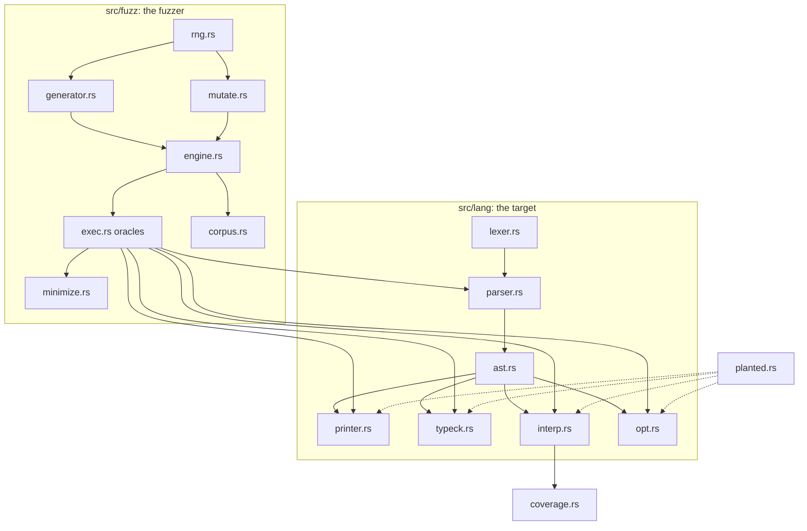

# Architecture

AST-StateFuzzer is one library crate (`astfuzz`) plus a CLI binary and an optional libFuzzer harness.

| Module | Responsibility |
|---|---|
| `lang/ast.rs` | Typed AST, size/depth metrics, pre-order indexing of expressions and blocks (used by mutators and the minimizer). |
| `lang/lexer.rs`, `lang/parser.rs` | Text → AST. 1 MiB input cap, nesting cap 200 (operator chains count too). |
| `lang/printer.rs` | AST → canonical text with minimal parentheses. |
| `lang/typeck.rs` | Static types (Int, Bool), lexical scopes. |
| `lang/interp.rs` | Reference semantics; checked arithmetic; fuel + wall-clock bound; emits coverage features. |
| `lang/opt.rs` | Constant folding and dead-branch removal that never hides a runtime error. |
| `planted.rs` | Four opt-in bugs used to prove the fuzzer works. |
| `fuzz/rng.rs` | Pinned xoshiro256** stream and a byte-driven source for libFuzzer. |
| `fuzz/generator.rs` | Type-aware program generation under budgets. |
| `fuzz/mutate.rs` | Eight tree mutations. |
| `fuzz/exec.rs` | Runs every oracle; captures panics with location; classifies failures. |
| `fuzz/minimize.rs` | Signature-preserving, cost-decreasing reduction. |
| `fuzz/corpus.rs` | Disk format, canonical and behavioural dedup. |
| `fuzz/engine.rs` | The loop, statistics, JSON report. |

## Data flow of one iteration

1. `Rng::fork(seed, i)` creates the iteration's private random stream. Corpus admission depends only on earlier
   iterations, so a campaign is a deterministic function of `(seed, config, seed corpus)`.
2. With probability `generate_percent` a fresh program is generated; otherwise a corpus entry gets 1–3 mutations
   (with another entry as splice donor).
3. Programs over 400 nodes or deeper than 40 are discarded (keeps every recursive pass far from stack limits).
4. `exec::check` runs the oracles in order and stops at the first failure:
   round trip → reference run (crash / timeout) → type soundness → optimizer equivalence.
5. A failure is deduplicated by **signature** (`class:oracle` or `crash:stage:file:line:normalized message`).
   The first program with a new signature is minimized and recorded; later hits only bump `duplicates`.
6. A passing, non-timed-out program that exhibits a new coverage feature joins the corpus.

## Failure classes

| Class | Signature | Raised when |
|---|---|---|
| crash | `crash:<stage>:<file>:<line>:<message with digits → N>` | any panic in printer, parser, type checker, interpreter or optimizer |
| timeout | `timeout:fuel` / `timeout:wall-clock` | the reference run exhausts its budget **and** `--timeouts-are-failures` is set |
| invariant-violation | `invariant-violation:<oracle>` | `roundtrip-parse`, `roundtrip-ast`, `type-soundness`, `optimizer-equivalence` |

A timed-out reference run skips the later oracles, because a partial run says nothing reliable about them.

## Design trade-offs

- **In-process execution.** Fast (tens of thousands of programs per second) and simple, and safe *because Mini has
  no side effects*. A panic is caught with `catch_unwind`; a stack overflow or abort would kill the process, which
  is why depth is bounded before execution and `panic = "abort"` must never be set.
- **Own RNG.** xoshiro256** in 30 lines instead of a crate so published seeds cannot change under a dependency
  update. `rng_stream_is_pinned` guards it.
- **Semantic coverage instead of instrumentation.** Portable and deterministic, but coarser than edge coverage;
  the libFuzzer harness is the route to real edge feedback.
- **Typed generation with a little noise.** Mostly well-typed programs reach deep semantics; ~3 % ill-typed
  operands keep the type checker and dynamic checks honest.

## Fuzzing other targets safely (sandboxing guidance)

Mini programs cannot touch the host, so in-process execution is safe here. A target that **executes real code**
(a compiler whose output you run, a shell, a database) is different. If you adapt the engine to one:

- Run each test case in a **separate process**, never in the fuzzer's own address space.
- Apply OS limits to that process: CPU time and address-space rlimits (`setrlimit` RLIMIT_CPU / RLIMIT_AS), a
  wall-clock kill, a process-count limit, and an empty or read-only working directory.
- Remove ambient authority: no network namespace (or a firewall), a minimal environment (no tokens or keys), an
  unprivileged user; on Linux use namespaces/seccomp (e.g. `bwrap`, `nsjail`), on macOS `sandbox-exec` profiles,
  or a disposable VM/container.
- Treat the target's output as untrusted text when writing reports.
- Never point a fuzzer at systems you do not own; all execution should stay local and bounded.
